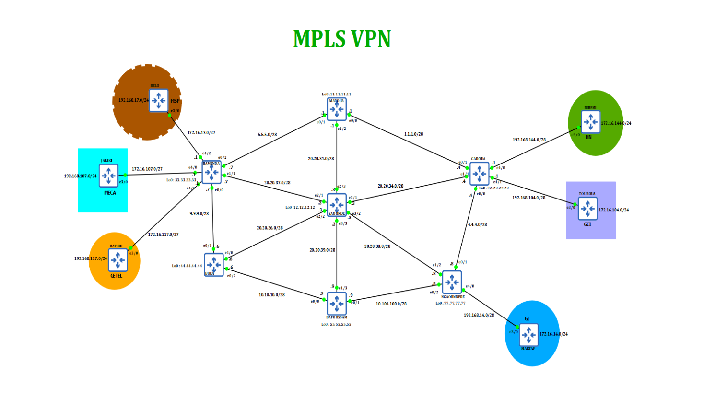

# 🔐 Architecture MPLS L3VPN (VRF, LDP & MP-BGP VPNv4) — Simulation Cisco IOS / EVE-NG


-FF6F00?style=for-the-badge)


Conception, implémentation et analyse d'une infrastructure opérateur **MPLS Layer 3 VPN (RFC 4364)** sous **Cisco IOS** et **EVE-NG**. Ce laboratoire interconnecte plusieurs sites distants de départements de l'ENSPY (`GETEL`, `HN`, `MECA`, `GCI`, `MSP`, `GI`) à travers un cœur de réseau maillé composé de **routeurs P (*Provider*)**, **routeurs PE (*Provider Edge*)** et **routeurs CE (*Customer Edge*)**, en s'appuyant sur **OSPFv2**, **LDP**, les instances **VRF** et **MP-BGP VPNv4**.

---

## 📑 Table des Matières

1. [Architecture & Topologie](#-architecture--topologie)
2. [Plan d'Adressage IP & Rôles des Routeurs](#-plan-dadressage-ip--rôles-des-routeurs)
3. [Segmentation VRF, Route Distinguishers & Route Targets](#-segmentation-vrf-route-distinguishers--route-targets)
4. [Mécanismes MPLS-VPN Déployés](#-mécanismes-mpls-vpn-déployés)
5. [Structure du Dépôt](#-structure-du-dépôt)
6. [Commandes de Vérification & Diagnostic](#-commandes-de-vérification--diagnostic)
7. [Auteur & Encadrement](#-auteur--encadrement)

---

## 📐 Architecture & Topologie



L'infrastructure repose sur une architecture hiérarchique à **13 routeurs** répartis en trois couches :
* **4 Routeurs Cœurs (`P` — *Provider*) :** `YAOUNDE` (nœud central en étoile), `MAROUA`, `BUEA` et `BAFOUSSAM` — commutent uniquement les paquets sur la base du **label de transport LDP** sans connaissance des routes clientes.
* **3 Routeurs de Bordure (`PE` — *Provider Edge*) :** `BAMENDA`, `GAROUA` et `NGAOUNDERE` — hébergent les instances **VRF**, maintiennent les sessions **MP-BGP VPNv4** et assurent l'encapsulation/désencapsulation du double label (*Transport Label + VPN Label*).
* **6 Routeurs Clients (`CE` — *Customer Edge*) :** `BELO` (`MSP`), `JAKIRI` (`MECA`), `BATIBO` (`GETEL`), `BIBEMI` (`HN`), `TOUROUA` (`GCI`) et `MARTAP` (`GI`).

---

## 📊 Plan d'Adressage IP & Rôles des Routeurs

### 1. Backbone MPLS (Routeurs `P` et `PE`)

| Routeur | Rôle | Loopback0 (`/32`) | Plage LDP | Interfaces du Backbone (`/28`) |
| :--- | :---: | :---: | :---: | :--- |
| **`YAOUNDE`** | **P** | `12.12.12.12` | `800 – 899` | `e2/3`: `20.20.31.3` (Maroua) \| `e3/1`: `20.20.34.3` (Garoua) \| `e2/2`: `20.20.36.3` (Buea) \| `e2/1`: `20.20.37.3` (Bamenda) \| `e3/2`: `20.20.38.3` (Ngaoundéré) \| `e3/3`: `20.20.39.3` (Bafoussam) |
| **`MAROUA`** | **P** | `11.11.11.11` | `100 – 199` | `e0/0`: `1.1.1.1` (Garoua) \| `e0/1`: `5.5.5.1` (Bamenda) \| `e1/2`: `20.20.31.1` (Yaoundé) |
| **`BUEA`** | **P** | `44.44.44.44` | `400 – 499` | `e0/1`: `9.9.9.6` (Bamenda) \| `e0/2`: `10.10.10.6` (Bafoussam) \| `e1/0`: `20.20.36.6` (Yaoundé) |
| **`BAFOUSSAM`** | **P** | `55.55.55.55` | `500 – 599` | `e0/0`: `10.10.10.9` (Buea) \| `e0/1`: `10.100.100.9` (Ngaoundéré) \| `e1/3`: `20.20.39.9` (Yaoundé) |
| **`BAMENDA`** | **PE** | `33.33.33.33` | `300 – 399` | `e0/2`: `5.5.5.7` (Maroua) \| `e0/0`: `9.9.9.7` (Buea) \| `e1/1`: `20.20.37.7` (Yaoundé) |
| **`GAROUA`** | **PE** | `22.22.22.22` | `200 – 299` | `e0/1`: `1.1.1.4` (Maroua) \| `e0/0`: `4.4.4.4` (Ngaoundéré) \| `e1/1`: `20.20.34.4` (Yaoundé) |
| **`NGAOUNDERE`** | **PE** | `77.77.77.77` | `700 – 799` | `e0/1`: `4.4.4.8` (Garoua) \| `e0/2`: `10.100.100.8` (Bafoussam) \| `e1/2`: `20.20.38.8` (Yaoundé) |

### 2. Liens d'Accès PE–CE & Réseaux Locaux Clients (LAN)

| Routeur CE | Entité / VRF | Routeur PE rattaché | Lien WAN (PE $\leftrightarrow$ CE) | Réseau LAN Client (`e0/0`) |
| :--- | :---: | :---: | :--- | :--- |
| **`BATIBO`** | `GETEL` | `BAMENDA` (`e4/1`) | `172.16.117.0/27` (PE: `.1` \| CE `e3/0`: `.30`) | `192.168.117.0/24` (`.1`) |
| **`BIBEMI`** | `HN` | `GAROUA` (`e4/0`) | `192.168.144.0/28` (PE: `.1` \| CE `e3/0`: `.14`) | `172.16.144.0/24` (`.1`) |
| **`JAKIRI`** | `MECA` | `BAMENDA` (`e4/0`) | `172.16.107.0/27` (PE: `.1` \| CE `e3/0`: `.30`) | `192.168.107.0/24` (`.1`) |
| **`TOUROUA`** | `GCI` | `GAROUA` (`e4/1`) | `192.168.104.0/28` (PE: `.1` \| CE `e3/0`: `.14`) | `172.16.104.0/24` (`.1`) |
| **`BELO`** | `MSP` | `BAMENDA` (`e4/2`) | `172.16.17.0/27` (PE: `.1` \| CE `e3/0`: `.30`) | `192.168.17.0/24` (`.1`) |
| **`MARTAP`** | `GI` | `NGAOUNDERE` (`e4/0`) | `192.168.14.0/28` (PE: `.1` \| CE `e3/0`: `.14`) | `172.16.14.0/24` (`.1`) |

---

## 🧩 Segmentation VRF, Route Distinguishers & Route Targets

Pour isoler les tables de routage tout en autorisant les communications inter-sites entre entités homologues de l'ENSPY, chaque VPN utilise un **RD (*Route Distinguisher*)** et des **RT (*Route Targets* import/export)** dédiés (ASN `65005`) :

| VPN / Tunnel Inter-Sites | Sites Connectés | Routeurs PE | Route Distinguisher (`RD`) | Route Target (`RT` both) |
| :--- | :--- | :--- | :---: | :---: |
| **VPN 1 (`GETEL` $\leftrightarrow$ `HN`)** | `BATIBO` $\leftrightarrow$ `BIBEMI` | `BAMENDA` $\leftrightarrow$ `GAROUA` | `65005:100` | `65005:100` |
| **VPN 2 (`MECA` $\leftrightarrow$ `GCI`)** | `JAKIRI` $\leftrightarrow$ `TOUROUA` | `BAMENDA` $\leftrightarrow$ `GAROUA` | `65005:200` | `65005:200` |
| **VPN 3 (`MSP` $\leftrightarrow$ `GI`)** | `BELO` $\leftrightarrow$ `MARTAP` | `BAMENDA` $\leftrightarrow$ `NGAOUNDERE` | `65005:300` | `65005:300` |

---

## 🔍 Mécanismes MPLS-VPN Déployés

1. **Plan de Transport (*Underlay*) :**
   * **OSPFv2 Area 0** assure la connectivité IP interne entre les 7 routeurs du backbone (`P` et `PE`) et annonce les `Loopback0` (`/32`).
   * **CEF + LDP** établissent les chemins commutés par labels (**LSP**) entre les `Loopback0` des routeurs PE avec plages de labels distinctes par routeur (`100–899`).
2. **Virtualisation & Isolation (`VRF`) :**
   * Création des instances VRF sur les routeurs PE (`BAMENDA`, `GAROUA`, `NGAOUNDERE`) et rattachement des interfaces d'accès clients via `ip vrf forwarding <VRF>`.
3. **Plan de Contrôle VPN (`MP-BGP VPNv4`) :**
   * Établissement de sessions iBGP entre les routeurs PE via leurs interfaces `Loopback0` (`update-source loopback0`).
   * Activation de la famille d'adresses **`address-family vpnv4`** avec échange des communautés étendues (`send-community both`) et redistribution mutuelle entre les protocoles PE–CE (routage statique / OSPF par VRF) et BGP.
4. **Double Empilement de Labels (*Label Stacking*) :**
   * Lors de la traversée du cœur MPLS, chaque paquet client transporte **deux étiquettes** (`[MPLS: Labels <Transport>/<VPN> Exp 0]`) : le label externe (LDP) oriente le paquet jusqu'au PE de sortie (avec *Penultimate Hop Popping* sur le dernier routeur P), tandis que le label interne (MP-BGP) identifie la VRF de destination sur le PE récepteur.

---

## 📁 Structure du Dépôt

```text
├── README.md                     # Documentation complète de l'architecture MPLS-VPN
├── topologie.png                 # Schéma complet (13 routeurs P, PE, CE et domaines VRF)
├── 11_mpls_vpn.unl               # Projet EVE-NG complet prêt à importer
├── TPE_n°11_MPLS_VPN_v2.pdf      # Compte-rendu détaillé (configurations, LFIB, VRF, captures)
└── config/                       # Fichiers de configuration Cisco IOS par routeur
    ├── YAOUNDE.ios               # Routeur P central (Lo0: 12.12.12.12 — Labels 800-899)
    ├── MAROUA.ios                # Routeur P Nord (Lo0: 11.11.11.11 — Labels 100-199)
    ├── BUEA.ios                  # Routeur P Sud-Ouest (Lo0: 44.44.44.44 — Labels 400-499)
    ├── BAFOUSSAM.ios             # Routeur P Ouest (Lo0: 55.55.55.55 — Labels 500-599)
    ├── BAMENDA.ios               # Routeur PE (VRF GETEL, MECA, MSP)
    ├── GAROUA.ios                # Routeur PE (VRF HN, GCI)
    ├── NGAOUNDERE.ios            # Routeur PE (VRF GI)
    ├── BATIBO.ios                # Routeur CE (Site GETEL)
    ├── BELO.ios                  # Routeur CE (Site MSP)
    └── JAKIRI.ios                # Routeur CE (Site MECA)
